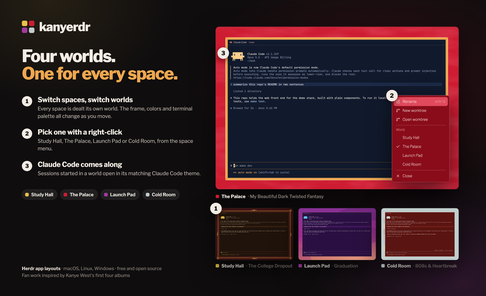
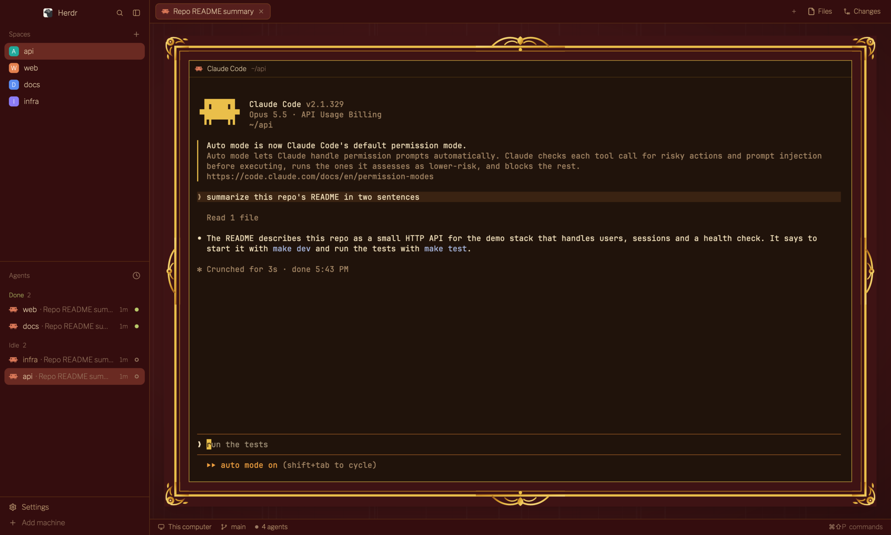
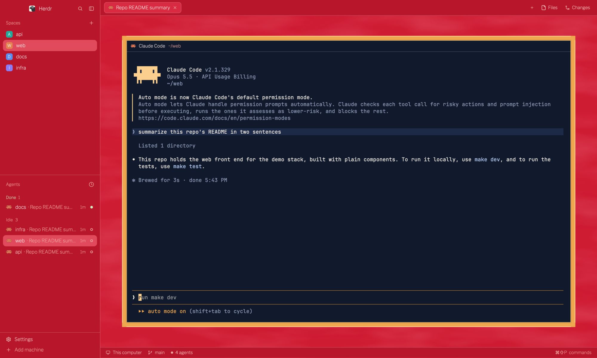
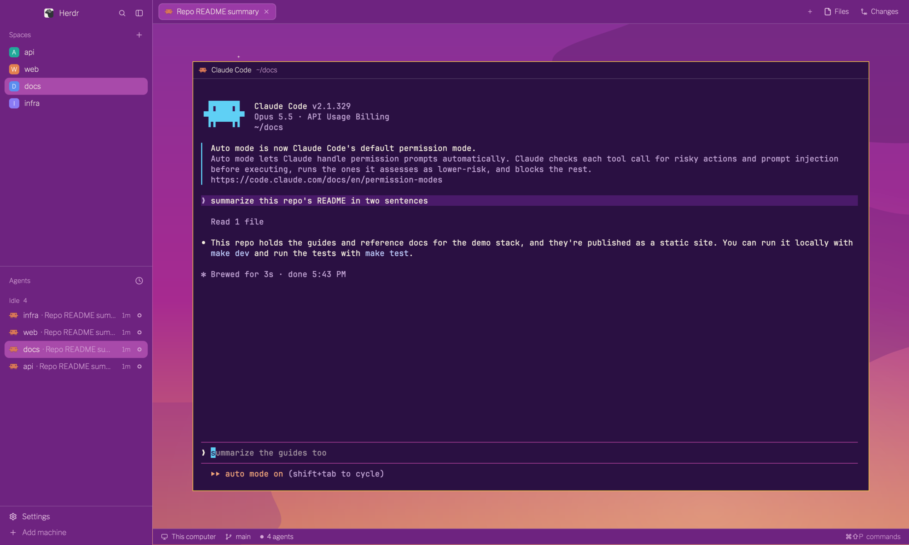
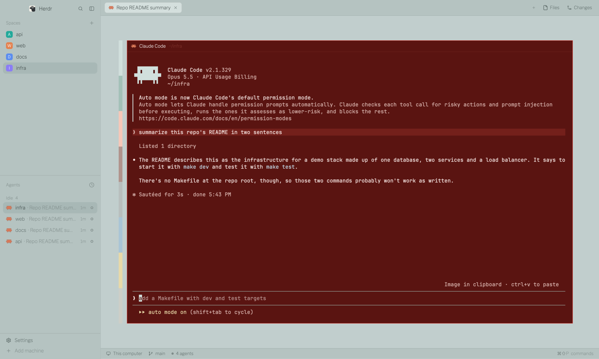
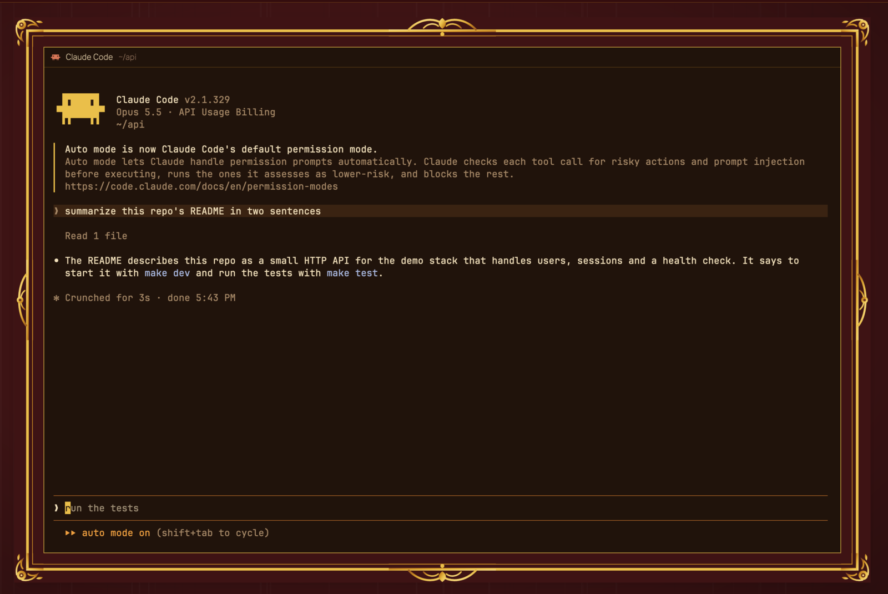
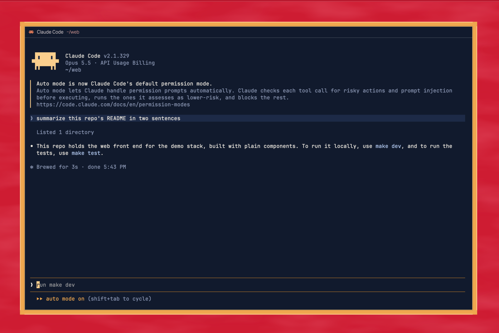
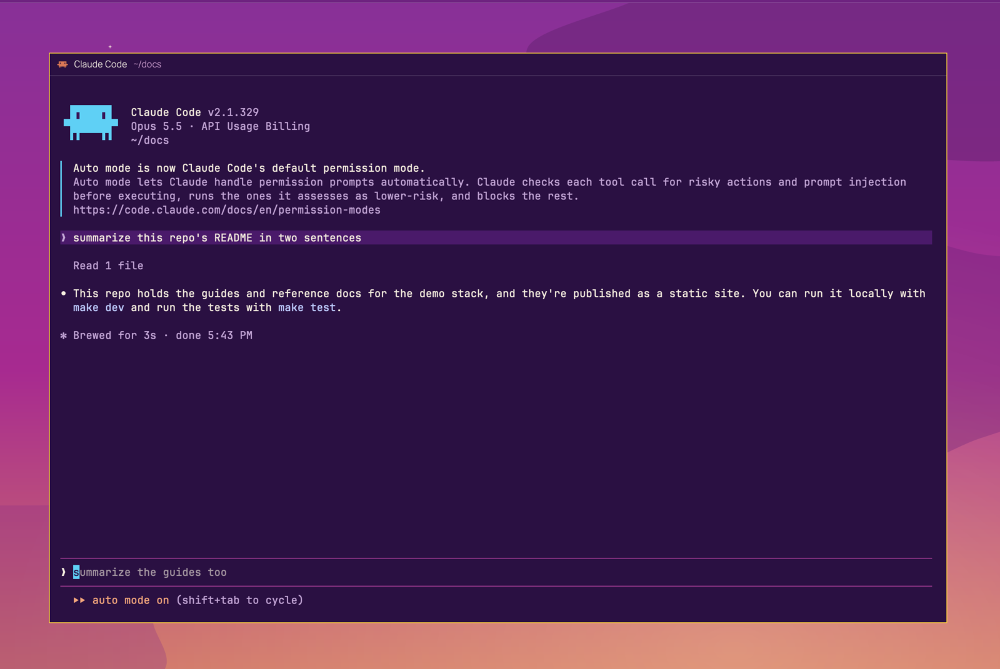
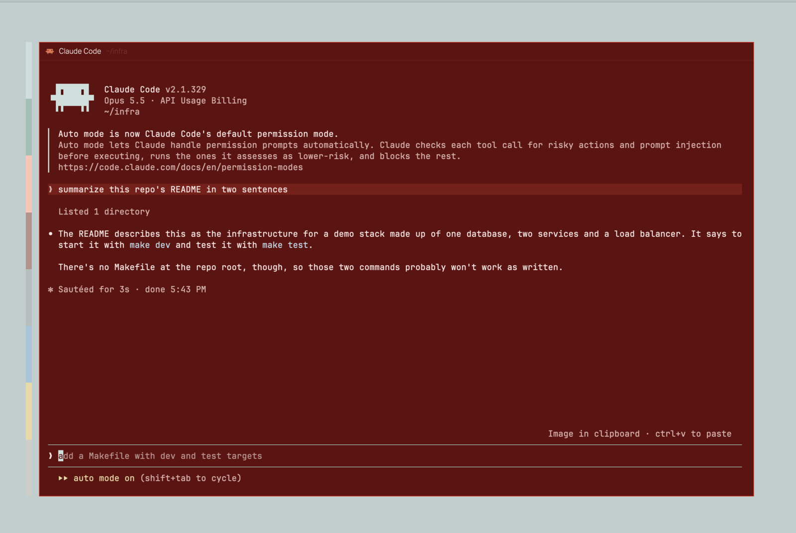
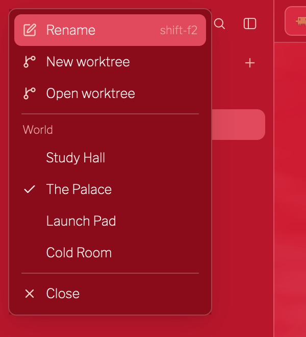

# kanyerdr

Four [Herdr](https://herdr.dev) layouts that change with the space you're in, each
one inspired by one of Kanye West's first four albums.



[](LICENSE)
[](https://herdr.dev)
[](#platform-support)

Most Herdr layouts are one look for the whole window. kanyerdr is four, and it
picks between them for you: every space wears a world, and when you switch spaces
the window switches with you. The frame, the colors, the terminal palette and
(if you want it) the Claude Code theme all follow.

## The four worlds

### Study Hall



Late nights in a wood-paneled library: maroon walls, a carved gold frame, warm
parchment text. Inspired by *The College Dropout*.

Terminal `#20130b` · text `#f3e2bd` · cursor `#eabf4a` · selection `#5a3416` · frame `#eabf4a` / `#c98a22`

### The Palace



A gallery wall in saturated red, with a plain gilt band around deep navy panes.
Inspired by *My Beautiful Dark Twisted Fantasy*.

Terminal `#111a2d` · text `#f2ede4` · cursor `#fbcf8d` · selection `#2d5589` · window `#ce1c32` · gilt `#efa74f`

### Launch Pad



A cartoon dusk sky in purple, pink and orange, with no frame at all. Bright cyan,
yellow and pink accents. Inspired by *Graduation*.

Terminal `#2a1042` · text `#f6efe0` · cursor `#5fd0f5` · selection `#7c2081` · accent `#ffd23f`

### Cold Room



Quiet and flat: pale grey-green walls, one column of pastel swatches, deep red
terminals. Inspired by *808s & Heartbreak*.

Terminal `#5a1411` · text `#f6e6e3` · cursor `#d1dfdc` · selection `#7d2620` · window `#c1cecd` · accent `#c82c24`

## Features

- New spaces get the world the fewest spaces wear, so four spaces show all four.
- Right-click a space to give it a different world.
- The frame, background art, interface colors and the 16 terminal colors your
  shell, editor and tools use all change together.
- Optionally, Claude Code sessions started in a world open in its matching theme,
  and your global Claude Code setting stays as it is.
- Spaces on your other machines get worlds too (not yet tried with a second
  machine).
- There's no config file to edit and no space IDs to copy.

## Install

You need [Herdr](https://herdr.dev) 0.1.16 or later. `git` is optional: the
sidebar uses it to show branches.

### With your agent

Ask the coding agent in Herdr:

```text
Add herdr.dev/layouts/maloqab/kanyerdr
```

It reads [`kanyerdr/RECIPE.md`](kanyerdr/RECIPE.md), tells you what the mods run,
copies the files, and switches you to Study Hall.

### By hand

Herdr keeps its files in its home folder: the folder with Herdr's own
`AGENTS.md`. On macOS and Linux that is `~/.config/herdr-app` (or
`$XDG_CONFIG_HOME/herdr-app`, or `$HERDR_APP_HOME` if you set it).

macOS and Linux:

```sh
git clone https://github.com/maloqab/kanyerdr
cd kanyerdr/kanyerdr
HERDR_HOME="${HERDR_APP_HOME:-${XDG_CONFIG_HOME:-$HOME/.config}/herdr-app}"
# Stop if any of the names is already taken; nothing is overwritten.
for f in layouts/*.json themes/*.json mods/*; do
  [ -e "$HERDR_HOME/$f" ] && { echo "already there: $HERDR_HOME/$f"; exit 1; }
done
for d in layouts themes mods; do mkdir -p "$HERDR_HOME/$d" && cp -R "$d/." "$HERDR_HOME/$d/"; done
herdr-app do layout.switch '{"name":"study-hall"}'
```

Windows (PowerShell). Set `$herdr` to the folder that holds Herdr's `AGENTS.md`:

```powershell
git clone https://github.com/maloqab/kanyerdr
cd kanyerdr\kanyerdr
$herdr = "C:\path\to\herdr-app"
# Stop if any of the names is already taken; nothing is overwritten.
$taken = foreach ($d in 'layouts', 'themes', 'mods') {
  Get-ChildItem $d | Where-Object { Test-Path (Join-Path "$herdr\$d" $_.Name) } | ForEach-Object { "$d\$($_.Name)" }
}
if ($taken) { "already there: $taken"; return }
foreach ($d in 'layouts', 'themes', 'mods') {
  New-Item -ItemType Directory -Force "$herdr\$d" | Out-Null
  Copy-Item -Recurse -Path "$d\*" -Destination "$herdr\$d"
}
herdr-app do layout.switch '{"name":"study-hall"}'
```

Both stop before copying if any of the names is already taken. The four layout
names (`study-hall`, `the-palace`, `launch-pad`, `cold-room`) are also the world
names the mods and the Claude Code wrapper look for, so they can't be renamed. The
mods can, with care; your agent knows how from the recipe.

### Update

Delete the four layouts, four themes and four mods listed under
[Uninstall](#uninstall) from the Herdr home, then install again. Your worlds
assignments are kept.

## Optional: Claude Code themes

Each world has a matching [Claude Code](https://code.claude.com) theme. A small
`claude` wrapper for your shell reads which world the terminal is in and starts
Claude Code in that theme.



<details>
<summary>The other three</summary>





</details>

From the `kanyerdr/kanyerdr` folder of your clone:

zsh (macOS default):

```sh
mkdir -p ~/.claude/themes && cp claude-code/themes/*.json ~/.claude/themes/
echo "source \"$PWD/claude-code/shell/kanyerdr.zsh\"" >> ~/.zshrc
```

bash (Linux, Git Bash, WSL):

```sh
mkdir -p ~/.claude/themes && cp claude-code/themes/*.json ~/.claude/themes/
echo "source \"$PWD/claude-code/shell/kanyerdr.bash\"" >> ~/.bashrc
```

PowerShell (Windows PowerShell 5.1 or PowerShell 7):

```powershell
New-Item -ItemType Directory -Force "$env:USERPROFILE\.claude\themes" | Out-Null
Copy-Item claude-code\themes\*.json "$env:USERPROFILE\.claude\themes\"
Add-Content $PROFILE ". `"$PWD\claude-code\shell\kanyerdr.ps1`""
```

Open a new terminal, then run `claude` in any space.

The wrapper defines a function named `claude`. It replaces an existing `claude`
alias or function, so merge yours in first if it adds options you need. If an
alias was your only way to reach Claude Code (its older `~/.claude/local`
install), the wrapper keeps calling what the alias pointed to.

## How worlds are assigned

- The first time Herdr shows a space, kanyerdr gives it the world the fewest
  spaces wear. Ties go in order: Study Hall, The Palace, Launch Pad, Cold Room.
- That choice is saved and doesn't change on its own.
- To change it, right-click the space in the sidebar and pick a world:

  

- Worlds switch only among themselves. If you switch to another layout by hand
  (`ctrl-shift-l`), it stays until you pick a world again.
- Each Herdr window keeps its own assignments, the same way it keeps its own
  space colors.

## What happens to running terminals and sessions

| | When a space changes world |
|---|---|
| Shells, editors, `git`, anything using the 16 terminal colors | Redraw in the new palette right away. |
| Claude Code sessions already running | Keep the theme they started with. Restart them, or run `/theme` and pick the new world. |
| New Claude Code sessions | Open in the new world's theme. |
| Your global Claude Code theme | Never changes. The wrapper passes the theme with `--settings` for that session only. |
| `claude` outside Herdr, or without `hc` | Runs exactly as before. |
| Other agents (Codex and others) | Use the world's terminal colors; they have no theme of their own to switch. |

Under the hood, kanyerdr labels every terminal with its world
(`kanyerdr.world=study-hall`, see `hc get <terminal>`), and the wrapper reads that
label. The themes build on Claude Code's `dark-ansi` theme, so any color they
don't set follows the terminal palette.

## Platform support

| | Layouts and mods | Claude Code wrapper |
|---|---|---|
| macOS | Tested (Herdr 0.1.16, macOS 27) | Tested: zsh, bash, PowerShell 7.7 |
| Linux | Expected to work, not yet run | zsh and bash scripts tested on macOS, not yet on Linux |
| Windows | Expected to work, not yet run | PowerShell script tested with PowerShell 7.7 on macOS, not yet on Windows |

On Linux and Windows the window buttons are drawn by Herdr's own tab bar, which
no world draws over. If you run kanyerdr on Linux or Windows, please
[open an issue](https://github.com/maloqab/kanyerdr/issues) and say how it went.

## Uninstall

1. Switch to another layout (`ctrl-shift-l`).
2. Delete from the Herdr home: `layouts/{study-hall,the-palace,launch-pad,cold-room}.json`,
   `themes/` files with the same names, and `mods/{worlds,world-spaces,world-menu,cold-pane}/`.
3. If you added the Claude Code part, delete the four theme files from
   `~/.claude/themes/`, the `~/.claude/kanyerdr/` folder (PowerShell only), and the
   `source` line from your shell's startup file.

The saved assignments are one unused entry (`worlds.assign`) in Herdr's
`shared.json`; you can leave it.

## Credits

Inspired by The College Dropout, My Beautiful Dark Twisted Fantasy, Graduation and 808s & Heartbreak. Fan work, not affiliated with Kanye West or his labels.

All artwork is original SVG. No album art, logos or photos are used.

Built on [Herdr](https://herdr.dev). `world-spaces`, `world-menu` and `cold-pane`
are modified copies of Herdr's own `spaces`, `menu` and `pane` mods.

## License

The code is under the [Apache License 2.0](LICENSE). Libre Franklin, in
`kanyerdr/mods/worlds/fonts/`, is under the
[SIL Open Font License 1.1](kanyerdr/mods/worlds/fonts/OFL.txt).
