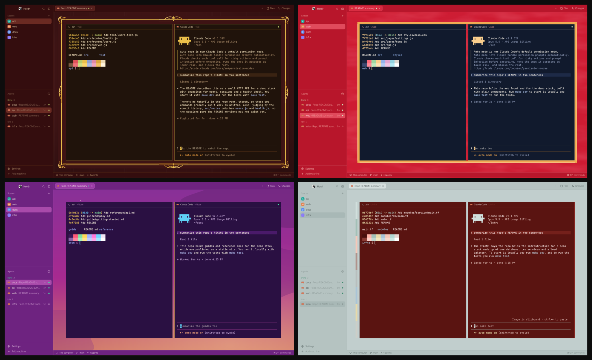

# kanyerdr

Four Herdr layouts, called worlds, that take turns as you move between spaces. Every
space wears one world: Study Hall (maroon and gold, a carved picture frame), The
Palace (red with a gilt band), Launch Pad (a purple and orange sky) or Cold Room
(pale grey-green with a red terminal). Switch spaces and the whole window changes
with you: frame, colors, terminal palette, and, if you opt in, the Claude Code
theme of sessions started there. Inspired by The College Dropout, My Beautiful
Dark Twisted Fantasy, Graduation and 808s & Heartbreak. Fan work, not affiliated
with Kanye West or his labels.

## What you see

All four worlds share one window plan (sizes in logical px):

- Sidebar, left, 268 wide. Herdr's brand row (46 tall), then the spaces list
  (`world-spaces`) and the agents list stacked half and half, then a 69-tall
  footer (Settings, Add machine). With more than one machine, spaces are grouped
  under a heading per machine: "This computer", then each machine's name, in
  Libre Franklin 13, weight 600.
- Tab bar, top, 42 tall (Herdr's `tabs`), draggable to move the window.
- The world's frame around the terminals: a 44-wide border on all four sides,
  drawn by the `worlds` mod, with the active tab's panes inside. Panes have a
  30-tall header, a 1 px border, 10 px gaps and square corners. Terminal text has
  14 × 12 px padding.
- Files / Changes panel, right, 368 wide, hidden until opened.
- Status bar, bottom, 28 tall (Herdr's `workspace-status`).
- The interface font is Libre Franklin (shipped in `mods/worlds/fonts/`).

Per world:

| World | Behind the window | Frame | Terminal (bg / fg / cursor / selection) | Accent |
|---|---|---|---|---|
| Study Hall | maroon panel art, `art/study-hall-maroon.svg` | gold: two bars, 4 px `#eabf4a` at 18 px and 1 px `#c98a22` at 27 px from the outer edge; 44 px corner ornaments; a 160 × 44 ornament mid top and bottom, 44 × 120 mid left and right | `#20130b` / `#f3e2bd` / `#eabf4a` / `#5a3416` | `#eabf4a` |
| The Palace | red, `art/the-palace-red.svg` | 32 px of red, then a 12 px gilt band touching the panes: 2 px `#fbcf8d`, 9 px `#efa74f`, 1 px `#b97a2a` | `#111a2d` / `#f2ede4` / `#fbcf8d` / `#2d5589` | `#fbcf8d` |
| Launch Pad | purple-to-orange sky, `art/launch-pad-sky-v3.svg` | none: the sky shows through; panes are `#151112` at 91% | `#2a1042` / `#f6efe0` / `#5fd0f5` / `#7c2081` | `#ffd23f` |
| Cold Room | flat `#c1cecd` | one detail: 22 px in from the left, a 10 px column of eight swatches top to bottom (`#d1dfdc` `#a3c0b7` `#f6c7b8` `#b0938c` `#b8bebd` `#a9c4d6` `#e8d9a8` `#cdcec7`); panes use the `cold-pane` header | `#5a1411` / `#f6e6e3` / `#d1dfdc` / `#7d2620` | `#c82c24` |

Each world has a theme of the same name in `themes/` with its 16 ANSI colors and
interface colors. The sidebar and bars use the theme's `canvas` and `chrome`
(Study Hall `#3e1314`/`#340d0e`, The Palace `#ce1c32`/`#b8162b`, Launch Pad
`#843198`/`#6e2380`, Cold Room `#c1cecd`/`#b5c3c1`).

## How it behaves

- Every space gets a world. The first time a space is seen it is dealt the
  world the fewest spaces wear, ties broken in the order Study Hall, The Palace,
  Launch Pad, Cold Room. Four new spaces get one world each; the fifth is Study
  Hall again. The choice is saved (shared state `worlds.assign`) and stays put.
  A deleted space's entry is dropped. Spaces on a machine that is offline keep
  their world until the machine is back.
- Switching spaces switches the world. Focus a space and the window moves to
  its world's layout at once. This only happens while a world is shown: pick
  another layout by hand (`main`, say, with `ctrl-shift-l`) and it stays until
  you pick a world again.
- Change a space's world. Right-click a space in the sidebar. Below Rename
  (and the worktree items when the space is a git checkout) is a World
  section: Study Hall, The Palace, Launch Pad, Cold Room, with a check on the
  current one. Pick one and, if that space is shown, the window switches to it.
  Close is still last. ↑/↓ and Enter work as in Herdr's own menu.
- Terminals are labelled. Every terminal in a space gets the label
  `kanyerdr.world=<world>` (`hc get <t>` shows it), and is relabelled when the
  space changes world. New terminals are labelled as they appear. A label that
  can't be written (machine offline) is retried at most every 30 seconds, with no notification.
- Terminal colors follow at once. Shells, editors and anything else that uses
  the 16 colors redraw in the new world's palette when the world changes.
- Claude Code (optional part). With the launcher sourced, `claude` started in
  a world opens in that world's Claude Code theme (mascot, prompt border, your
  message background, diff and mode colors). The theme is passed for that session
  only (`--settings`), so the person's global Claude Code theme is untouched. A
  session that is already running keeps its theme when the space changes world:
  restart it, or run `/theme` and pick the new one. Outside Herdr, in a terminal
  without the label, or without `hc`, `claude` runs exactly as before.
- Agent status uses each theme's colors in the agents list, tab bar and pane
  headers: working (Study Hall `#eabf4a`, The Palace `#fbcf8d`, Launch Pad
  `#3ad0ff`, Cold Room `#4a7aa0`), blocked (`#ff6a4a`, `#ffffff`, `#ff4f7a`,
  `#c82c24`; Cold Room's header shows a "Needs you" pill), done (`#b9c96a`,
  `#d0f0c0`, `#46e3a6`, `#3f8a6e`), idle (`#9c7b63`, `#f2aaa2`, `#d8a8d8`,
  `#7f8c8a`).

## Built from

- `layouts/study-hall.json`, `the-palace.json`, `launch-pad.json`,
  `cold-room.json`. Root: `theme` = the layout's name, `ui_font` "Libre Franklin",
  `terminal_padding` [14, 12], `titlebar` "none", `traffic_lights` [12, 16],
  `background` (the art, or Cold Room's color). Tree: `root` row → `sidebar`
  column (`brand` block `workspace-chrome`, `sidebar-lists` with `spaces` block
  `world-spaces` and `agents` block `agents`, `sidebar-footer` block
  `workspace-chrome {footer: true}`) and `work` column (`tabs` block `tabs`;
  `work-body` row with a `frame` column of 3 × 3 blocks around `main`, plus the
  `panel` stack of `files` and `changes`; `status` block `workspace-status`; a
  1 px `worlds` block with no props, the switcher).
- The frame blocks are `{mod: "worlds", props: {part}}` with part `tl`, `top`,
  `tr`, `left`, `right`, `bl`, `bottom`, `br`; corner and side blocks are 44 px.
  `main` is `{tab: "active", pane: {header: {content: {mod: "pane"}}, …}}`
  (`cold-pane` in Cold Room).
- `themes/<world>.json`: one per layout, same names.
- `mods/worlds/`: `main.js` (switcher and frame parts), `assign.js` (pure logic:
  `WORLDS`, `leastUsed`, `reconcile`, `labelPlan`), `art/` (SVG), `fonts/`
  (Libre Franklin, OFL 1.1). Uses `spaces()`, `panes()`, `machines()`,
  `focused()`, `layouts()`, `shared`/`setShared`, `run("layout.switch")`, and
  **runs `hc label`** on terminals.
- `mods/world-spaces/`: a clone of Herdr's `spaces` sidebar (0.1.15) with machine
  headings, opening `world-menu` on right-click. **Runs `hc machine ls`** to list
  machines and, from its Reconnect button for an unreachable machine, **`hc
  machine rm` and `hc machine add`**. **Runs `git`** through `exec`
  (on the space's machine) for branch status.
- `mods/world-menu/`: a clone of Herdr's `menu` (0.1.16) with the World section.
  **Runs `git`** through `exec` to offer worktree items, as Herdr's menu does.
- `mods/cold-pane/`: a clone of Herdr's `pane` header (0.1.15) for Cold Room.
- Shipped mods used as they are: `workspace-chrome`, `agents`, `tabs`, `files`,
  `changes`, `workspace-status`, `pane`.
- `claude-code/themes/<world>.json`: Claude Code custom themes (`base`
  `dark-ansi` plus `overrides`). `claude-code/shell/kanyerdr.zsh`,
  `kanyerdr.bash`, `kanyerdr.ps1`: a `claude` function that reads the terminal's
  label with `hc get "$HC_TERMINAL_ID" --json` and runs the real `claude` with
  `--settings '{"theme":"custom:<world>"}'` (PowerShell passes the same JSON in a
  file in the temp folder). No python or jq needed.

No mod reaches the network. Beyond its own folder, `world-spaces` watches each
space's git checkout for changes (`watchFolder`) to keep branch status fresh, as
Herdr's own `spaces` does.

## Install (for agents)

1. Copy `layouts/`, **`themes/`** and `mods/` into the Herdr home: the folder
   that holds Herdr's own `AGENTS.md` (`$HERDR_APP_HOME`, else
   `$XDG_CONFIG_HOME/herdr-app`, else `~/.config/herdr-app`). The four layouts, four
   themes and four mods belong together and nothing may be overwritten. The
   layout names are the world ids (`study-hall`, `the-palace`, `launch-pad`,
   `cold-room`) that `assign.js`, `world-menu` and the Claude Code launchers look
   for, so they can't be renamed: if one is taken, stop and ask the person. A
   taken mod name can be renamed consistently: the `mod` names in all four
   layouts and the `mods/<name>/` paths inside the mods (`world-spaces` opens
   `world-menu` by name).
2. `herdr-app check <Herdr home>/mods/<name>` for each of the four mods (it
   takes the folder path, not the name).
3. `herdr-app do layout.switch '{"name":"study-hall"}'`. From then on, moving
   between spaces moves between worlds.
4. Claude Code themes (ask first): this part writes outside Herdr's folder.
   If the person wants it:
   - Copy `claude-code/themes/*.json` to `~/.claude/themes/`
     (`%USERPROFILE%\.claude\themes\` on Windows).
   - Add one line to their shell's startup file: zsh `~/.zshrc`:
     `source /path/to/kanyerdr.zsh`; bash `~/.bashrc`: `source
     /path/to/kanyerdr.bash`; PowerShell `$PROFILE`: `. C:\path\to\kanyerdr.ps1`.
     Keep the script somewhere stable (not a temp download folder). Terminals
     that were already open pick it up once restarted.
   - If they already have a `claude` alias or function, show it and ask before
     replacing it: the launcher removes the alias and defines its own function.
     (If the alias was the only way to reach Claude Code, the launcher keeps
     calling what it pointed to.)

## Watch out

- Assignments belong to one window: `worlds.assign` lives in that Herdr
  home's shared state, so each screen deals and remembers worlds on its own, as
  space colors do.
- Worlds only switch among themselves. On any other layout the switcher
  isn't loaded, so nothing is dealt or labelled until a world is shown again.
- Running Claude sessions keep their theme; only new ones pick up a changed
  world. Other agents (Codex and the like) get the world's terminal colors but
  have no theme of their own to switch.
- The clones are frozen: `world-spaces`, `world-menu` and `cold-pane` don't
  follow later changes to Herdr's `spaces`, `menu` and `pane`.
- The four names travel together. Renaming one layout without its theme, or a
  mod without updating all four layouts, breaks that world.
- Linux and Windows: the layouts use `titlebar: "none"`. On those systems the
  shipped `tabs` mod draws minimize, maximize and close in the tab bar, which no
  world draws over. `traffic_lights` only matters on macOS.
- `world-spaces` needs `git` for branch status; without it spaces still work.

## Done when

- `herdr-app check` passes for `worlds`, `world-spaces`, `world-menu` and
  `cold-pane`.
- With Study Hall shown, four new spaces are dealt Study Hall, The Palace,
  Launch Pad and Cold Room in that order; a fifth gets Study Hall.
- Selecting each space switches the window to its world's layout.
- Switching to `main` by hand and then selecting another space leaves `main`.
- `hc get <t> --json` shows `"kanyerdr.world":"<world>"` for terminals in each
  space.
- Right-clicking a space shows the World section with a check on its world;
  picking Cold Room saves it, switches the window to Cold Room and relabels the
  space's terminals; the check moves.
- With the launcher sourced, `claude` in a Cold Room space opens in the Cold Room
  theme. After the space is moved to Study Hall, that session is still Cold Room
  and a new `claude` in the same space opens in Study Hall.
